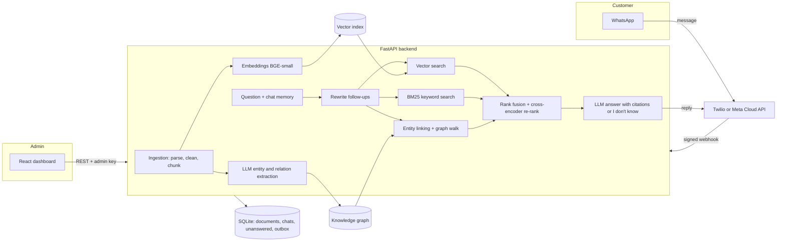

# GraphRAG WhatsApp Support Bot

A customer-support chatbot that learns from a company's own documents and answers customers on WhatsApp. A company uploads its documents (PDF, Word, text files or web pages) in an admin dashboard. The bot splits them into chunks, indexes them for search, and builds a knowledge graph of the products, prices, branches, people and policies in them. When a customer sends a WhatsApp message, the bot finds the relevant facts, writes a short answer, and says which document the answer came from. If the answer is not in the documents, it says so and offers to pass the chat to a human instead of making something up.

I built this to learn how retrieval-augmented generation (RAG) works in a realistic setting, and to test whether adding a knowledge graph (GraphRAG) actually helps compared with plain vector search. The demo uses documents I wrote for a fictional Sri Lankan electronics retailer, Nilaveli Electronics.

## What it does

- **Document ingestion.** Upload PDF, DOCX, TXT, Markdown or HTML files, add a web page by URL, or paste FAQ text. Tables in Word files are kept as readable rows, and every chunk remembers its heading and page number.
- **Knowledge graph.** An LLM extracts entities (products, prices, warranty plans, branches, opening hours, people) and relationships between them. Entities with the same name from different documents are merged, so facts in different files get connected.
- **Hybrid retrieval.** Each question goes through three searches: dense vector search (BGE embeddings), BM25 keyword search, and a graph walk from the entities named in the question. The results are merged with Reciprocal Rank Fusion and re-ranked with a cross-encoder, whose score is blended with the fused rank.
- **Grounded answers.** The LLM only sees the numbered sources and graph facts, has to cite them, and returns structured JSON that says whether the question was answerable. Unanswerable questions are logged for the company to fill in.
- **WhatsApp.** Works with the Twilio WhatsApp sandbox or the official Meta WhatsApp Cloud API. Webhook signatures are verified, duplicate deliveries are ignored, replies are sent in the background, and each phone number has its own conversation memory.
- **Human handover.** If a customer asks for a person, the bot stops replying and the conversation shows up in the dashboard, where an agent can reply and later hand it back.
- **Admin dashboard.** Manage documents, explore the knowledge graph, test-chat with a view of exactly which chunks and graph facts were used, read conversation logs, review unanswered questions, and see evaluation results.
- **Evaluation.** 30 test questions (single-hop, multi-hop and unanswerable) comparing vector-only RAG, hybrid search and GraphRAG. GraphRAG answered 96% correctly vs 92% for vector-only, with the gain on multi-hop questions.

## Architecture



### How a multi-hop question is answered

Take "How long is the compressor warranty on the Nila AirCool 12000?". The product catalog says the AirCool 12000 has the *Gold Care* plan, and a separate policy PDF says Gold Care covers the inverter compressor for 10 years. The policy chunk never mentions the AirCool, so a plain vector search can miss it. In the graph, `Nila AirCool 12000 -HAS_WARRANTY-> Gold Care -COVERS-> 10 year compressor warranty` connects the two. The graph walk starts at the product, reaches the policy chunk two hops away, and passes both chunks plus the connecting facts to the LLM.

## Tech stack and why

| Part | Choice | Why |
|---|---|---|
| API | Python, FastAPI | Async webhooks, background tasks, automatic API docs at `/docs` |
| LLM | Google Gemini (`gemini-3.5-flash-lite`, free tier) or Anthropic Claude (`claude-opus-5-5`) | Gemini's free tier means the project runs at no cost. Claude is supported for higher quality. Both use JSON-schema structured output, so the code never parses free text |
| Embeddings | FastEmbed with `BAAI/bge-small-en-v1.5` | Runs on CPU through ONNX, no API key, small enough for free hosting |
| Re-ranker | `ms-marco-MiniLM-L-6-v2` cross-encoder | Reads question and chunk together. Its score is blended 50/50 with the fused rank, because on its own it scored some correct chunks near zero |
| Vector index | NumPy, saved to disk | One company's documents are thousands of chunks at most, where exact search takes about a millisecond. A vector database would add operations work without better results. The store has a small interface, so it can be swapped for Qdrant or pgvector |
| Graph store | NetworkX, saved as JSON | No extra server to run, and it has Personalized PageRank built in. Neo4j would be the next step for very large graphs |
| Database | SQLite | Documents, chunks, conversations, unanswered questions and the outbox, with no setup |
| Dashboard | React, TypeScript, Vite, react-force-graph | Fast to build, and the graph view is interactive |
| WhatsApp | Twilio sandbox or Meta Cloud API | Twilio is the quickest way to test; Meta is the official production route |

I did not use LangChain or LlamaIndex. The pipeline is small enough that writing it directly made every step visible and testable, which was the point of the project.

## Evaluation

The evaluation builds a fresh index from `sample_data/` and asks 30 questions with each retrieval mode: 13 single-hop questions, 13 multi-hop questions whose answers need facts from two places, and 4 questions whose answers are not in the documents.

- **Context recall**: share of the facts needed for the answer that were in the retrieved chunks.
- **Answer accuracy**: the answer contains every required fact (a strict keyword check).
- **Refusal accuracy**: unanswerable questions correctly declined.
- **Faithfulness, answer relevance, correctness**: RAGAS-style scores from an LLM judge (0 to 1).

Results with Gemini (`gemini-3.5-flash-lite`) answering and building the graph, top 6 chunks per question (full table in `eval/results/llm.md`):

| Metric | Vector only | Hybrid (vector + BM25 + re-ranker) | GraphRAG (hybrid + graph) |
|---|---|---|---|
| Context recall | 96.2% | 96.2% | **98.1%** |
| All needed facts retrieved | 92.3% | 92.3% | **96.2%** |
| Answer accuracy (26 answerable) | 92.3% | 92.3% | **96.2%** |
| Multi-hop answer accuracy (13) | 84.6% | 84.6% | **92.3%** |
| Single-hop answer accuracy (13) | 100% | 100% | 100% |
| Correctly says "I don't know" (4) | 100% | 100% | 100% |
| Faithfulness (LLM judge) | 1.00 | - | 1.00 |
| Answer relevance (LLM judge) | 0.99 | - | 0.98 |
| Correctness (LLM judge) | 0.94 | - | 0.95 |
| Median latency | 1.5 s | 3.9 s | 2.6 s |

What I take from this:

- GraphRAG helped where I expected it to, on multi-hop questions. For example, "Can I pay for the AirCool 12000 in instalments?" needs the price from the catalog and the Rs. 75,000 minimum from the payment policy. Vector search did not retrieve the policy chunk, so that answer said it did not know; the graph linked them.
- The gain is small: one more correct question out of 26. With a test set this size, that is a direction, not proof.
- No mode made anything up. On the question all three missed (the normal price of the free fan in the sale), the bot said it did not have that information instead of guessing.
- In offline mode (no LLM: heuristic graph and extractive answers, `eval/results/offline.md`), retrieval shows the same pattern (96.2% vs 92.3% of questions with all facts retrieved), but answer accuracy is only about 50%, because copying sentences is not the same as answering.

Things that did not work, and what I changed:

- My first run showed GraphRAG slightly *worse* than vector search. Looking at the failures, the cross-encoder re-ranker was scoring some correct chunks near zero and pushing them out. Blending its score 50/50 with the fused rank fixed this for both hybrid and GraphRAG.
- I tried reserving context slots for "bridge" chunks (evidence about entities one hop away). It pushed out good chunks and lowered recall, so I removed it.
- One of my "unanswerable" questions ("Do you sell iPhones?") was actually answered by the FAQ (only Nila products are sold), so I relabelled it.
- Because I made these changes after seeing results on the same 30 questions, the final numbers are probably a little optimistic. A fresh, larger question set would be the honest next test.

Run it yourself:

```bash
python eval/run_eval.py            # uses the LLM from .env
python eval/run_eval.py --offline  # no API calls: heuristic graph and extractive answers
python eval/run_eval.py --reuse-index --retrieval-only   # re-test retrieval on the existing index, no API calls
```

## Run it locally

You need Python 3.11 or newer and Node 20 or newer.

```bash
git clone https://github.com/pamithudulwan892-max/graphrag-whatsapp-bot.git
cd graphrag-whatsapp-bot
cp .env.example .env          # then add your keys, see below
pip install -r backend/requirements-dev.txt
cd dashboard && npm install && npm run build && cd ..
cd backend && uvicorn app.main:app --port 8000
```

Open http://127.0.0.1:8000, sign in with the `ADMIN_API_KEY` from `.env`, and upload the files in `sample_data/` (or your own). For dashboard development with hot reload, run `npm run dev` in `dashboard/` and open http://localhost:5173.

With Docker:

```bash
docker compose up --build
```

To test the WhatsApp path without a phone, the simulator sends a correctly signed Twilio webhook and prints the reply:

```bash
python scripts/simulate_whatsapp.py "Is delivery free for a rice cooker to Colombo?"
```

Tests:

```bash
cd backend && python -m pytest -q
```

## Getting the API keys

**Gemini (free).** Go to [aistudio.google.com](https://aistudio.google.com), sign in, click *Get API key*, then *Create API key*, and put it in `.env` as `GEMINI_API_KEY`. No card is needed. The free tier limits requests per minute and Google may use free-tier prompts to improve its products, so use a paid key for real customer data.

**Claude (optional, paid).** Create a key at [console.anthropic.com](https://console.anthropic.com) under *Settings, API Keys*, add a few dollars of credit, and set `ANTHROPIC_API_KEY` (and `LLM_PROVIDER=anthropic` if both keys are set).

**Twilio WhatsApp sandbox (quickest for testing).**
1. Create a free account at [twilio.com](https://www.twilio.com) and open *Messaging, Try it out, Send a WhatsApp message*.
2. From your phone, send the join code shown there to the sandbox number.
3. Copy the Account SID and Auth Token into `.env` (`TWILIO_ACCOUNT_SID`, `TWILIO_AUTH_TOKEN`).
4. In the sandbox settings, set *When a message comes in* to `https://<your-public-url>/webhooks/twilio` (method POST).
5. Set `PUBLIC_BASE_URL` to the same public URL and `WHATSAPP_DRY_RUN=false`.

**Meta WhatsApp Cloud API (production).**
1. At [developers.facebook.com](https://developers.facebook.com) create an app of type *Business* and add the *WhatsApp* product.
2. Under *WhatsApp, API Setup*, copy the temporary access token and the phone number ID into `META_ACCESS_TOKEN` and `META_PHONE_NUMBER_ID`, and add your own number as a test recipient.
3. Copy the app secret from *App settings, Basic* into `META_APP_SECRET`, and choose any string for `META_VERIFY_TOKEN`.
4. Under *WhatsApp, Configuration*, set the callback URL to `https://<your-public-url>/webhooks/meta`, enter the same verify token, and subscribe to the `messages` field.
5. Set `WHATSAPP_PROVIDER=meta` and `WHATSAPP_DRY_RUN=false`.

For local testing, `ngrok http 8000` gives you a public HTTPS URL.

## Free deployment

The live demo runs on **Render's free tier**: https://graphrag-whatsapp-bot.onrender.com

- `render.yaml` is a Render Blueprint. In Render, choose *New, Blueprint*, give it this repository, and paste your `GEMINI_API_KEY` when asked. Render builds the `Dockerfile` (dashboard, API and models in one image) and generates a random `ADMIN_API_KEY`, which you can read under the service's *Environment* tab.
- Free Render services sleep after 15 minutes without traffic (the first request after that takes about a minute) and lose their files on restart. To handle this, the demo restores a prebuilt index of the sample documents (`sample_data/prebuilt_index/`, built by `eval/run_eval.py`) on startup instead of calling the LLM again. Documents you upload on the free tier disappear on restart; a paid disk or an external database would fix that.
- The re-ranker is switched off on Render (`USE_RERANKER=false`) to stay inside the free 512 MB of memory.
- **Dashboard on Vercel (optional).** The backend already serves the dashboard, but it can also be hosted on Vercel: import the repository, set the root directory to `dashboard`, and set `VITE_API_URL` to the Render URL. Add the Vercel URL to `CORS_ORIGINS` on the backend.

Vercel alone cannot run the backend: its functions are short-lived and stateless, so they cannot keep the indexes, the graph and the chat memory, or load the embedding model. Hugging Face Spaces was my first choice, but Docker Spaces now need a paid plan.

## Project layout

```
backend/app/
  ingestion/     parsers (PDF, DOCX, HTML, Markdown), chunker, pipeline
  graph/         LLM and heuristic extractors, NetworkX graph store
  retrieval/     vector store, BM25, graph retriever, hybrid fusion and re-ranking
  answer.py      prompts, citations, "I don't know" handling, follow-up rewriting
  services.py    message handling: memory, handover, rate limiting
  whatsapp.py    Twilio and Meta signatures, parsing and sending
  main.py        REST API, webhooks, dashboard hosting
backend/tests/   unit and API tests (offline, no keys needed)
dashboard/       React admin dashboard
eval/            test questions, evaluation script and results
sample_data/     demo documents for the fictional company
scripts/         sample document generator, WhatsApp simulator
```

## Limitations

- The evaluation set is small (30 questions) and written by me against documents I also wrote, so the numbers show the direction of the differences, not exact production accuracy. When the same LLM answers and judges, the judge scores can be optimistic.
- The free Gemini tier allows only a few requests per minute and a limited number per day (`gemini-2.5-flash` ran out after about 20 requests in a day, which is why the default is `gemini-3.5-flash-lite`). Building the graph for many documents is slow, and a busy WhatsApp number would need a paid key.
- The bot reads text messages only. Voice notes and images get a polite reply asking for text.
- Free Hugging Face Spaces lose uploaded documents on restart. A persistent disk or an external database would fix this.
